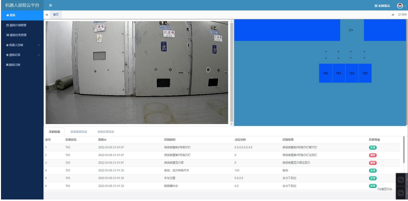
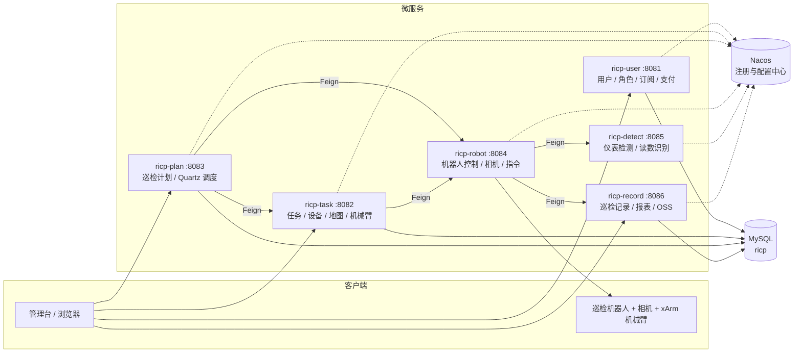
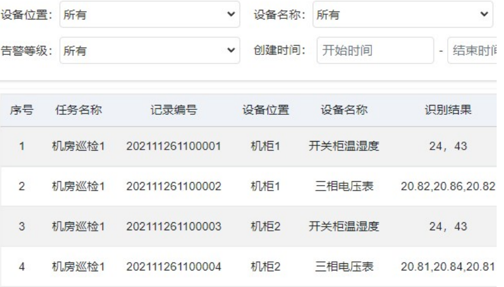
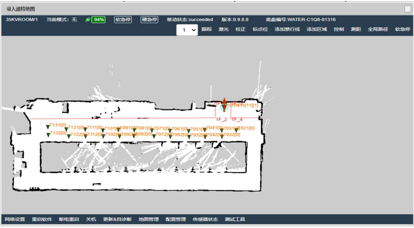

# 机器人巡检云平台（RICP）

基于 Spring Cloud 微服务 + 计算机视觉的工业仪表巡检云平台：机器人在机房 / 配电间巡检，云端下发计划、控制机械臂与相机采集仪表图像，检测服务识别读数，记录服务入库并生成告警与报表，用户按订阅方式使用平台服务。

> 武汉科技大学 国家级大学生创新创业训练计划项目（结题），与库柏特科技联合完成工业仪表场景试点；已登记计算机软件著作权。



---

## ⚠️ 先看这里：这个仓库能跑出什么、跑不出什么

本项目在交付时**没有包含三类核心外部件**，因此「克隆下来能看到的」和「真实巡检能做的」是两件事。请先读完这张表再判断是否值得部署。

| 层次 | 能否复现 | 说明 |
|---|---|---|
| 后台页面（首页 / 计划 / 任务 / 记录 / 地图） | ✅ **可复现** | 4 个服务 + H2 内存库即可启动，见下方「本地演示运行」 |
| 业务流程与数据落库 | ✅ **可复现** | JPA 自动建表；新建 / 编辑 / 删除计划与任务可以走通 |
| 机器人巡检执行 | ❌ **不可复现** | 需要海康相机 SDK、xArm 机械臂、机器人本体 |
| 仪表读数识别 | ❌ **不可复现** | 依赖厂商原生库 `meterDetect.dll` + 模型权重（darknet 风格接口），未随代码分发 |

缺失清单：

| # | 缺的东西 | 代码中的位置 | 仓库里的现状 |
|---|---|---|---|
| 1 | 海康威视 SDK（`ClientDemo` / `HCNetSDK`） | `ricp-robot`、`ricp-task` 共 5 个类引用 | 已补**编译占位类**（`ricp-common/src/main/java/ClientDemo/`），只保证能编译启动，不连摄像头 |
| 2 | `meterDetect.dll` + `.cfg` / `.weights` | `ricp-detect/factory/DigitMeterDetect`、`MeterADetector` | 无，`Native.load("meterDetect.dll")` 会失败 |
| 3 | 机器人 / 机械臂 / 相机硬件 | `ricp-robot`（相机、指令下发）、`ricp-task`（xArm） | 无 |
| 4 | MySQL + Nacos | 各模块 `application.yml` | 演示时用 H2 内存库顶替、关闭 Nacos；生产配置原样保留 |

结论：**这是一个可运行的微服务骨架 + 完整业务流程建模，不是一个可演示的巡检系统。**

---

## 功能

| 模块 | 能力 |
|---|---|
| 计划管理 | 巡检计划的增删改查、周期配置、启停；Quartz 按周期触发巡检任务 |
| 任务调度 | 任务派发、设备与机器人绑定、SLAM 地图管理、机械臂（xArm）控制 |
| 图像采集 | 云边协同：云端下发指令，边缘侧驱动机器人与相机按点位采集 |
| 仪表识别 | 数字表（`DigitMeterDetect`）与指针表（`MeterADetector`）读数识别，检测器工厂 + 仓储管理 |
| 巡检记录 | 记录入库、历史数据查询、按设备/位置/告警等级过滤、报表导出 |
| 用户与订阅 | 注册登录、验证码、角色权限、平台服务订阅、支付宝支付、对象存储上传 |

## 系统架构



一次巡检的链路：

```
计划(Quartz) → 任务下发 → 机器人移动到点位 → 相机采集图像
   → detect 识别读数 → record 入库 → 记录页/报表/告警
```

## 技术栈

| 层次 | 选型 |
|---|---|
| 语言 / 构建 | Java 8、Maven 多模块 |
| 框架 | Spring Boot 2.3.3、Spring Cloud Hoxton.SR9、Spring Cloud Alibaba 2.2.2（Nacos） |
| 服务调用 | OpenFeign（客户端已写死 `http://localhost:808X`，不依赖注册中心也能互通） |
| 数据访问 | Spring Data JPA、Druid、MySQL（演示用 H2）、PageHelper |
| 调度 | Quartz（生产 JDBC JobStore，演示 RAMJobStore） |
| 视图 | Thymeleaf + RuoYi 风格后台模板 |
| 其他 | 阿里云 OSS、支付宝沙箱支付、Kaptcha 验证码 |
| 视觉 | JNA 调用厂商原生库（数字表 / 指针表读数量化） |

## 目录结构

```text
.
├── pom.xml                  # 聚合 + 父 POM（依赖与版本统一在此）
├── sql/                     # 业务表结构与 Nacos 表结构
├── docs/images/             # 界面截图
├── scripts/local-demo/      # 本地一键启动（H2，无需 MySQL/Nacos）
├── ricp-common/             # 通用返回体、分页、工具类；ClientDemo 为海康 SDK 编译占位
├── ricp-user/               # 用户、角色、订阅、支付（8081，页面也由它渲染）
├── ricp-task/               # 任务、设备、地图、机械臂（8082）
├── ricp-plan/               # 巡检计划、Quartz 调度（8083）
├── ricp-robot/              # 机器人控制、相机、指令下发（8084）
├── ricp-detect/             # 仪表检测与读数识别（8085）
└── ricp-record/             # 巡检记录、报表、对象存储（8086）
```

## 本地演示运行（无需 MySQL / Nacos）

**环境**：JDK 8（Spring Boot 2.3 不支持 JDK 17+）、Maven 3.6+。

```bash
# 1. 构建（一次即可）
mvn -DskipTests install

# 2. 生成依赖 classpath（一步）
mvn -pl ricp-user dependency:build-classpath -Dmdep.outputFile=scripts/local-demo/classpath.txt

# 3. 启动四个服务
powershell -ExecutionPolicy Bypass -File scripts\local-demo\start-all.ps1

# 4. 浏览器打开
#    http://localhost:8081
```

停止：`powershell -ExecutionPolicy Bypass -File scripts\local-demo\stop-all.ps1`

启动后可直接访问的页面：

| 路径 | 内容 |
|---|---|
| `/page/homepage` | 巡检总览（地图 + 视频位 + 数据表） |
| `/page/planPage` | 巡检计划管理 |
| `/page/taskPage` | 巡检任务管理 |
| `/page/recordPage` | 巡检记录 / 历史数据 |
| `/page/mapPage` | SLAM 地图 |

说明：

- 数据保存在 H2 内存库中，**重启即清空**，列表默认是空表。
- 演示启动参数里 `-Dricp.quartz.config=/quartz-demo.properties` 让 Quartz 走内存；不加则读生产配置 `quartz.properties`（JDBC JobStore + MySQL）。
- `addPlanPage` / `addTaskPage` 可以打开并提交，但任务真正执行会失败——需要机器人硬件。

## 生产部署（原始设计）

1. 起 MySQL，导入 `sql/tables_mysql.sql`（库名 `ricp`）。
2. 起 Nacos 2.x（默认 `127.0.0.1:8848`），导入 `sql/nacos-mysql.sql`。
3. 按需修改各模块 `application.yml`：数据库地址、`DB_PASSWORD` 环境变量、支付宝/OSS 密钥。
4. 依次启动 7 个服务（`mvn -pl ricp-user -am spring-boot:run` 或打成 jar 运行）。
5. 另需补齐上文「缺失清单」中的海康 SDK 与 `meterDetect.dll` 及模型权重。

## 界面

| 巡检计划 | 巡检记录 |
|---|---|
|  |  |

| 机器人 SLAM 地图 | 服务订阅 |
|---|---|
|  |  |

## 已知限制

- **静态资源只入库了 `ricp-user` 一份**（约 22 MB，页面依赖它）；`ricp-plan` / `ricp-task` / `ricp-record` 的 `static/` 是同一套模板的重复副本，未入库。
- Nacos 分发包（约 85 MB，含 `nacos-server.jar`）、各模块 `target/` 构建产物均未入库。
- 演示用 H2 与生产用 MySQL 存在少量方言差异（分页已指定 `helperDialect=h2`）。
- 数据库口令统一改为 `${DB_PASSWORD:111111}`，请勿在仓库内写死真实口令。

## 说明

- 本项目为团队项目：代码、文档与软著由团队共同完成，本仓库清理后作展示 / 归档用途。
- 原仓库提交历史（2022 年，含其他成员账号）已移除并重新初始化，不代表作者归属。
- `ricp-common/src/main/java/ClientDemo/` 下的两个类是**为编译补的占位实现**，不是原厂 SDK；真实部署请替换为海康官方 SDK。
- 若需用于商业用途，请先确认与项目参与方及合作企业的权利归属。
