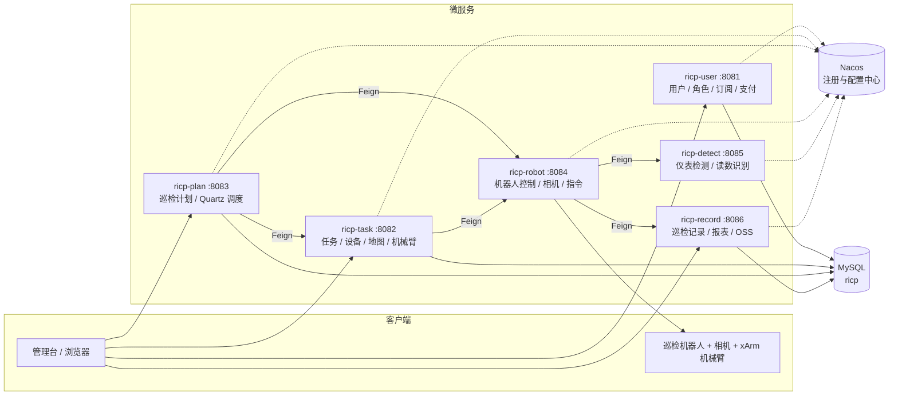

# 机器人巡检云平台（RICP）

基于 Spring Cloud 微服务 + 计算机视觉的工业仪表巡检云平台：机器人在机房/配电间巡检，云端下发计划、控制机械臂与相机采集仪表图像，检测服务识别读数，记录服务入库并生成告警与报表，用户按订阅方式使用平台服务。

> 武汉科技大学 国家级大学生创新创业训练计划项目（结题），与库柏特科技联合完成工业仪表场景试点；已登记计算机软件著作权。


## 功能

| 模块 | 能力 |
|---|---|
| 计划管理 | 巡检计划的增删改查、周期配置、启停；Quartz 按周期触发巡检任务 |
| 任务调度 | 任务派发、设备与机器人绑定、SLAM 地图管理、机械臂（xArm）控制 |
| 图像采集 | 云边协同：云端下发指令，边缘侧驱动机器人与相机按点位采集 |
| 仪表识别 | 数字表（`DigitMeterDetect`）与指针表（`MeterADetector`）读数识别，检测器工厂 + 仓储管理 |
| 巡检记录 | 记录入库、历史数据查询、按设备/位置/告警等级过滤、报表导出 |
| 用户与订阅 | 注册登录、验证码、角色权限、平台服务订阅、支付宝支付、对象存储上传 |

## 系统架构



一次巡检的链路：

```
计划(Quartz) → 任务下发 → 机器人移动到点位 → 相机采集图像
   → detect 识别读数 → record 入库 → 记录页/报表/告警
```

## 技术栈

| 层次 | 选型 |
|---|---|
| 语言 / 构建 | Java 8、Maven 多模块 |
| 框架 | Spring Boot 2.x、Spring Cloud Alibaba（Nacos 注册与配置） |
| 服务调用 | OpenFeign |
| 数据访问 | Spring Data JPA、Druid、MySQL、PageHelper |
| 调度 | Quartz（动态 Job、持久化任务） |
| 视图 | Thymeleaf |
| 其他 | 阿里云 OSS、支付宝沙箱支付、Kaptcha 验证码 |
| 视觉 | OpenCV / 深度学习检测器（数字表、指针表读数量化） |

## 目录结构

```text
.
├── pom.xml                  # 聚合 POM，7 个模块
├── sql/
│   ├── tables_mysql.sql     # 业务表结构
│   └── nacos-mysql.sql      # Nacos 配置中心表结构
├── docs/images/             # 界面截图
├── ricp-common/             # 通用返回体、分页、工具类
├── ricp-user/               # 用户、角色、订阅、支付（端口 8081）
├── ricp-task/               # 任务、设备、地图、机械臂（8082）
├── ricp-plan/               # 巡检计划、Quartz 调度（8083）
├── ricp-robot/              # 机器人控制、相机、指令下发（8084）
├── ricp-detect/             # 仪表检测与读数识别（8085）
└── ricp-record/             # 巡检记录、报表、对象存储（8086）
```

## 本地运行

1. 起 MySQL，导入 `sql/tables_mysql.sql`（库名 `ricp`）。
2. 起 Nacos（2.x，默认 `127.0.0.1:8848`），导入 `sql/nacos-mysql.sql`。
3. 按需修改各模块 `application.yml` 的数据库地址与密码：

```yaml
spring:
  datasource:
    url: jdbc:mysql://localhost:3306/ricp?serverTimezone=Asia/Shanghai&characterEncoding=utf-8
    username: root
    password: ${DB_PASSWORD:111111}   # 用环境变量 DB_PASSWORD 覆盖，勿写死在仓库里
```

4. 依次启动 7 个服务（或按依赖先起 `ricp-user`、`ricp-task`）：

```bash
mvn -pl ricp-user -am spring-boot:run
mvn -pl ricp-task -am spring-boot:run
# plan 8083 / robot 8084 / detect 8085 / record 8086 同理
```

5. 浏览器访问 `http://localhost:8081`。

## 界面

| 巡检计划 | 巡检记录 |
|---|---|
|  |  |

| 机器人 SLAM 地图 | 服务订阅 |
|---|---|
|  |  |

## 已知限制

- **静态资源未纳入仓库**：各模块 `src/main/resources/static/`（RuoYi 前端模板、UEditor、ECharts 等第三方资源，约 21 MB × 4 份重复）已排除，克隆后页面样式与脚本会缺失；需要完整可运行版本请走 release 附件。
- 配置中的数据库口令统一改为 `DB_PASSWORD` 环境变量，默认回退到开发用值。
- Nacos 分发包（约 85 MB，含 `nacos-server.jar`）不纳入仓库，请自行下载 2.x 版本。

## 说明

- 本项目为团队项目：代码、文档与软著由团队共同完成，本仓库仅清理后作展示/归档用途，未包含第三方分发包与构建产物。
- 原仓库提交历史（2022 年，含他人账号）已移除并重新初始化，不代表作者归属。
- 若需用于商业用途，请先确认与项目参与方及合作企业的权利归属。
